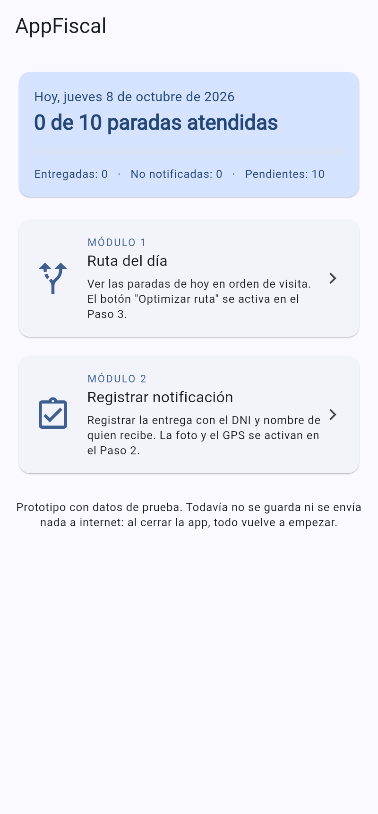
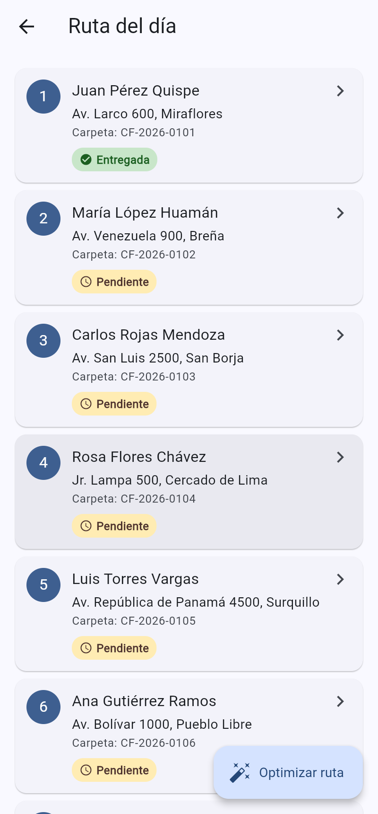
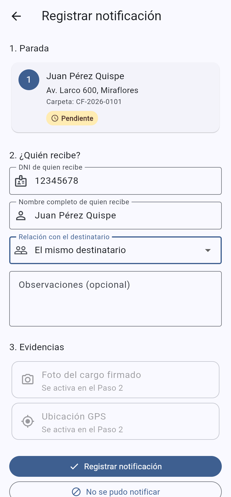
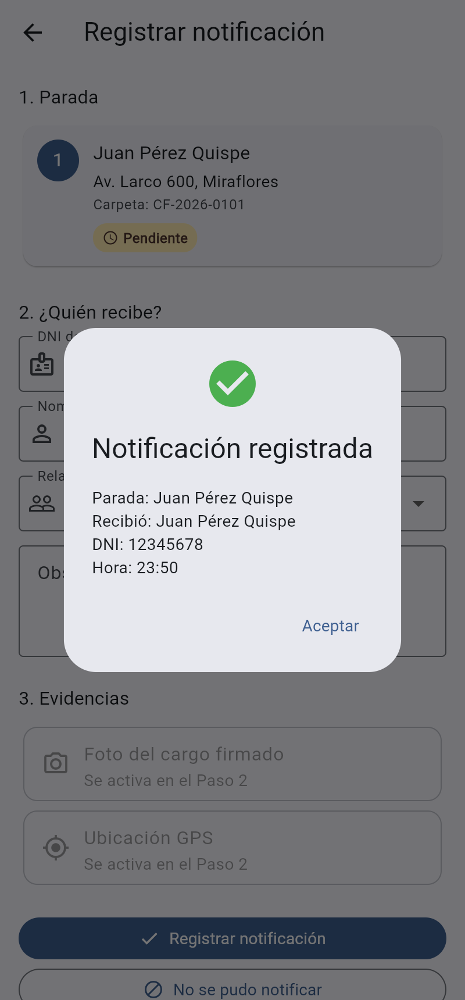

# AppFiscal

Prototipo (MVP) de app móvil para notificadores, hecho en **Flutter**. Tiene dos módulos:

- **Módulo 1: Ruta del día.** Muestra las paradas del día y, más adelante, calculará el orden que recorre menos kilómetros.
- **Módulo 2: Registrar notificación.** Registra quién recibió (DNI y nombre), la foto del cargo firmado y la ubicación GPS.

<table>
  <tr>
    <td></td>
    <td></td>
    <td></td>
    <td></td>
  </tr>
</table>

Todos los datos que trae la app (nombres, direcciones, carpetas) son **de prueba e inventados**.

## Avance del proyecto

Construimos la app por pasos. Cada paso se prueba y se corrige antes de pasar al siguiente.

| Paso | Qué agrega | Estado |
|---|---|---|
| 1 | Esqueleto: inicio, ruta del día, formulario de registro con validación de DNI, 10 paradas de prueba | **Listo para probar** ([qué probar](docs/paso-01.md)) |
| 2 | Cámara (foto del cargo) y GPS real en el Módulo 2 | Pendiente |
| 3 | Mapa con las paradas (OpenStreetMap), botón "Optimizar ruta" (OSRM) con los km ahorrados, y botón "Navegar" que abre Waze o Google Maps | Pendiente |
| 4 | Guardar en la nube (Firebase): inicio de sesión del notificador y subida de foto y datos | Pendiente |
| 5 | Geocerca: no deja marcar "Entregada" si el notificador está lejos de la dirección | Pendiente |
| 6 | Firma en pantalla y constancia en PDF | Pendiente |
| 7 | Panel del coordinador y reporte de km y combustible para el informe | Pendiente |

## Instalar la app en tu celular Android (sin cables)

Cada vez que se sube un avance, GitHub revisa el código, corre las pruebas y crea el instalador de Android (APK) por su cuenta. Tarda unos 10 minutos.

1. En el celular, abre Chrome y entra a:
   **https://github.com/DennisMuchaRodriguez/AppFiscal-a-/releases/tag/apk-prueba**
2. En **Assets**, toca **AppFiscal.apk** para descargarlo.
3. Abre el archivo descargado. Android pedirá permiso para **instalar apps de origen desconocido** desde Chrome: actívalo y vuelve atrás.
4. Si aparece un aviso de **Play Protect** ("app no reconocida"), toca **Más detalles → Instalar de todas formas**. Sale porque la app no viene de Play Store.
5. Abre **AppFiscal**. Abajo, en el inicio, dice **"compilación #N"**: ese número te dice qué versión tienes.

Para actualizar, repite los pasos 1 a 3. La nueva versión se instala encima de la anterior.

Si quieres ver si ya terminó de compilar, entra a la pestaña **Actions** del repositorio: un círculo amarillo significa que está trabajando, un check verde que ya está listo y una X roja que falló.

## Cómo correr la app en tu computadora (primera vez)

Esta guía es para **Windows**. Solo se hace una vez.

### 1. Instalar las herramientas

1. **Git:** descárgalo de https://git-scm.com/download/win e instálalo con las opciones por defecto.
2. **Google Chrome**, si no lo tienes.
3. **Visual Studio Code (VS Code):** https://code.visualstudio.com
4. En VS Code, abre **Extensiones** (`Ctrl+Shift+X`), busca **Flutter** e instálala. También instala **Dart**.
5. **Instalar Flutter desde VS Code:**
   1. Presiona `Ctrl+Shift+P` y escribe `Flutter: New Project`.
   2. Saldrá un aviso de que no encuentra el SDK de Flutter. Elige **Download SDK**.
   3. Elige una carpeta simple, por ejemplo `C:\dev` (créala). **No** uses carpetas con espacios o tildes, como "Mis documentos" o "Archivos de programa".
   4. Espera a que termine. Cuando pregunte **Add SDK to PATH**, acepta.
   5. Si después te pide crear un proyecto nuevo, cancélalo. No lo necesitamos.
6. Cierra VS Code y vuelve a abrirlo. Abre una terminal (menú **Terminal → Nueva terminal**) y escribe:
   ```
   flutter doctor
   ```
   Debe salir ✓ en **Flutter** y en **Chrome**. Si **Android** sale con ✗, no importa para el Paso 1.

### 2. Descargar el proyecto

En la terminal de VS Code:

```
cd C:\dev
git clone -b claude/fervent-lamport-ixnjgw https://github.com/DennisMuchaRodriguez/AppFiscal-a-.git
```

Si te pide iniciar sesión en GitHub, se abrirá el navegador. Entra con tu cuenta.

Luego, en VS Code: **Archivo → Abrir carpeta…** y elige `C:\dev\AppFiscal-a-`.

Cuando haya un avance nuevo, lo descargas con:

```
git pull
```

### 3. Abrir la app en Chrome

En la terminal de VS Code (dentro de la carpeta del proyecto):

```
flutter pub get
flutter run -d chrome
```

La primera vez tarda uno o dos minutos. Se abrirá Chrome con la app.

- Para verla del tamaño de un celular: presiona `F12` y luego `Ctrl+Shift+M`.
- Mientras la app está abierta, en la terminal: `r` recarga tus cambios, `R` reinicia la app y `q` la cierra.

### 4. Abrir la app en un celular Android (opcional ahora, necesario desde el Paso 2)

1. Instala **Android Studio** (https://developer.android.com/studio), ábrelo una vez y completa el asistente. Eso descarga el SDK de Android.
2. En Android Studio: **More Actions → SDK Manager → pestaña SDK Tools**, marca **Android SDK Command-line Tools** y presiona **Apply**.
3. En la terminal: `flutter doctor --android-licenses` y responde `y` a todo.
4. En el celular: **Ajustes → Acerca del teléfono** y toca 7 veces **Número de compilación**. Luego ve a **Ajustes → Sistema → Opciones de desarrollador** y activa **Depuración por USB**.
5. Conecta el celular por USB y acepta el mensaje "¿Permitir depuración por USB?".
6. En la terminal: `flutter devices` (debe aparecer tu celular) y luego `flutter run`.

### Pruebas automáticas

```
flutter test
```

Debe terminar con `All tests passed!`.

## Cómo reportar un error

Cuando algo falle, envíame:

1. Qué hiciste (por ejemplo: "toqué la parada 3 y luego Registrar").
2. Qué esperabas que pasara.
3. Qué pasó en realidad.
4. El **texto completo** del error que sale en la terminal (normalmente en rojo), o una captura de pantalla.

## Cómo está organizado el código

```
lib/
  main.dart                   Punto de entrada: arranca la app
  models/                     Cómo son los datos (Parada, RegistroNotificacion)
  data/paradas_demo.dart      Las 10 paradas de prueba
  services/ruta_del_dia.dart  Guarda lo que pasa en el día y avisa a las pantallas
  screens/                    Las pantallas: inicio, ruta y registro
  widgets/                    Piezas que se repiten (tarjeta de parada, etiqueta de estado)
  utils/                      Validación del DNI y formato de fechas
test/                         Pruebas automáticas
android/, web/                Configuración de cada plataforma (casi nunca se toca)
```

Cambios sencillos para practicar (después de cada cambio, presiona `r` en la terminal):

- Cambiar una dirección o un nombre en `lib/data/paradas_demo.dart`.
- Cambiar las opciones de "Relación" o de "Motivos" en `lib/models/registro_notificacion.dart`.
- Cambiar el color principal (`seedColor`) en `lib/main.dart`.
